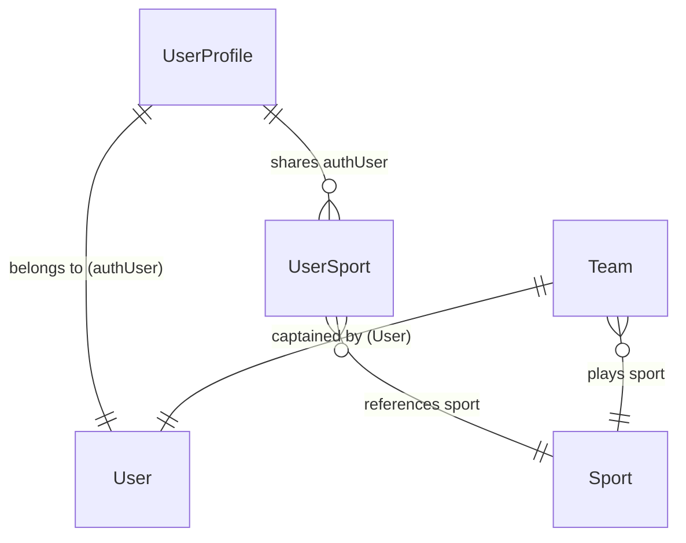

# Discovery Module Documentation

## 1. Purpose
The Discovery Module provides high-performance, privacy-safe geospatial search for nearby amateur players and opponent teams using dual-resolution Uber H3 hexagons combined with MongoDB `$geoNear` aggregation.

## 2. Responsibilities
- **Player Discovery**: Finding nearby eligible players by sport, specialist position, experience rating, and demographic filters.
- **Opponent Team Discovery**: Finding nearby registered amateur teams accepting match challenges.
- **H3 Geospatial Coverage**: Selecting appropriate H3 resolution (Res 7 vs Res 8) and computing conservative covering polygons.
- **Dynamic Aggregation Pipeline**: 10-stage aggregation ensuring indexed execution and server-side filtering.
- **Privacy Enforcement**: Coarse distance bands, no exposure of exact coordinates, private H3 cell IDs, or sensitive authentication details.
- **Relevance Ranking & Pagination**: Proximity and experience scoring with deterministic sort and offset pagination.

## 3. Folder Structure
```text
modules/discovery/
  controllers/
    discovery.controller.js
  services/
    playerDiscovery.service.js
    teamDiscovery.service.js
  pipelines/
    playerDiscovery.pipeline.js
    teamDiscovery.pipeline.js
  utils/
    discoveryRanking.js
  validations/
    discovery.validation.js
  routes/
    discovery.routes.js
  discovery.md
```

## 4. Models
Discovery consumes documents from:
- `UserProfile`: `location.geo` (Point), `location.isSharingEnabled`, `h3Cells.res7`, `h3Cells.res8`, `onboardingCompleted`, `availability`
- `User`: `username`, `playerCode`, `avatar`
- `UserSport`: `sport`, `authUser`, `preferredPositions`, `experienceLevel`, `isPrimarySport`
- `Sport`: `name`, `slug`, `hasPositions`, `positions`, `isActive`
- `Team`: `name`, `sport`, `captain`, `preferredPlayingLocation.geo`, `h3Cells`, `challengeEnabled`, `status`

## 5. Database Relationships


## 6. Controllers
- `searchPlayers(req, res, next)`: Validates input, executes player search service, returns ranked candidate players.
- `searchTeams(req, res, next)`: Validates input, executes team discovery service, returns candidate opponent teams.

## 7. Service Functions
- `searchPlayers(requestingUserId, params)`: Resolves sport, verifies position, selects H3 resolution (8 for ≤3km, 7 for >3km), computes covering cells, executes 10-stage pipeline, rechecks real-time effective availability, applies progressive radius expansion if empty.
- `searchTeams(requestingCaptainId, params)`: Discovers active opponent teams accepting challenges within search radius.

## 8. APIs
- `POST /api/v1/discovery/players/search` — Discover nearby players
- `POST /api/v1/discovery/teams/search` — Discover nearby opponent teams

## 9. Request Examples
### Player Search
```http
POST /api/v1/discovery/players/search
Authorization: Bearer <JWT_ACCESS_TOKEN>
Content-Type: application/json

{
  "sport": "football",
  "position": "midfielder",
  "searchLocation": {
    "type": "Point",
    "coordinates": [77.209, 28.6139]
  },
  "filters": {
    "minExperience": 6,
    "ageMin": 18,
    "ageMax": 35,
    "maxDistanceKm": 5,
    "gender": "male"
  },
  "autoExpandRadius": true,
  "page": 1,
  "limit": 20
}
```

## 10. Response Examples
```json
{
  "success": true,
  "message": "Players discovered successfully",
  "data": {
    "results": [
      {
        "userId": "6738b556b9c9f00123456789",
        "username": "rahul_striker",
        "playerCode": "7281946",
        "displayName": "Rahul Sharma",
        "avatar": { "url": "default-avatar" },
        "sport": "Football",
        "sportSlug": "football",
        "preferredPositions": ["midfielder", "forward"],
        "experienceLevel": 8,
        "experienceCategory": "Advanced",
        "isPrimarySport": true,
        "distanceBand": "1–3 km",
        "city": "New Delhi",
        "isAvailable": true,
        "availabilityStatus": "available",
        "discoveryScore": 0.88
      }
    ],
    "count": 1,
    "page": 1,
    "limit": 20,
    "meta": {
      "searchRadiusKm": 5,
      "selectedResolution": 7,
      "coveringCellCount": 19,
      "usedGeoFallback": false,
      "fallbackReason": null
    }
  }
}
```

## 11. Complete Request Flow
```text
Mobile / Web Client
  ↓ (POST /api/v1/discovery/players/search with JWT)
verifyJWT Middleware (verifies token, loads req.user)
  ↓
playerDiscoveryLimiter (Redis sliding-window rate limit)
  ↓
validatePlayerDiscoveryInput (validates coordinates, sport, filters)
  ↓
discovery.controller.js (coordinates request)
  ↓
playerDiscovery.service.js
  ├─ Resolves Sport document from catalogue
  ├─ Selects H3 resolution (res 8 for ≤3km, res 7 for >3km)
  ├─ Calls getSearchCoveringCells() for conservative hexagon bounds
  ├─ Checks candidate cell budget (max 800) -> triggers geo fallback if exceeded
  ├─ Builds & executes 10-stage aggregation pipeline on UserProfile
  ├─ Recomputes fresh real-time effective availability for each player
  └─ Maps distance to privacy-safe coarse distance bands
  ↓
JSON Response
```

## 12. MongoDB Queries & Pipelines
The 10-stage aggregation pipeline executes:
1. `$geoNear`: Initial spatial filter with spherical radius and optional H3 candidate cell match.
2. `$match`: Profile eligibility (`onboardingCompleted: true`, `location.isSharingEnabled: true`, age calculation, gender).
3. `$lookup` + `$unwind`: Join `users` to confirm active account and retrieve `playerCode` and `username`.
4. `$lookup` + `$unwind`: Join `usersports` to check player sports registrations.
5. `$match`: Matching `sport` ObjectId, position filter (handling specialist vs `not_sure`), experience rating.
6. Verified Rating Integration: Star rating placeholder.
7. `$addFields`: Discovery score (`0.7 * proximity + 0.3 * experience`).
8. `$sort`: Ranked by `discoveryScore: -1, distanceMeters: 1, _id: 1`.
9. `$skip` & `$limit`: Deterministic pagination.
10. `$project`: Strict privacy whitelist.

## 13. Indexes
- `UserProfile`:
  - `{ "location.geo": "2dsphere" }`
  - `{ "h3Cells.res7": 1, "availability.status": 1, "location.isSharingEnabled": 1 }`
  - `{ "h3Cells.res8": 1, "availability.status": 1, "location.isSharingEnabled": 1 }`
- `UserSport`:
  - `{ authUser: 1, sport: 1 }` (unique)
  - `{ sport: 1, experienceLevel: 1 }`
- `Team`:
  - `{ "preferredPlayingLocation.geo": "2dsphere" }`
  - `{ sport: 1, status: 1, challengeEnabled: 1, "h3Cells.res7": 1 }`

## 14. Redis Usage
- **Search Rate Limiting**: `ratelimit:discovery:players:<userId>` (30 req/min).
- **Team Discovery Limiting**: `ratelimit:discovery:teams:<userId>` (30 req/min).
- **Fallback**: Graceful in-memory tracking if Redis is offline.

## 15. Regex and Validation
- GeoJSON coordinates: `[-180 <= lng <= 180, -90 <= lat <= 90]`.
- Radius bounds: `1 <= radiusKm <= 20`.
- Experience bounds: `1 <= experienceLevel <= 10`.

## 16. Authorization
- Mandatory JWT authentication (`verifyJWT`).
- Automatic exclusion of the requesting player's own profile.
- Respects `location.isSharingEnabled: false` (players with sharing disabled never appear in search).

## 17. Security Considerations
- **No Coordinate Leaks**: Exact coordinates and fine H3 indexes are stripped from all projections.
- **Anti-Triangulation**: Coarse distance bands (`< 1 km`, `1–3 km`, `3–5 km`) prevent exact position trilateration.
- **Injection Protection**: Aggregation stages are built strictly server-side using validated parameters.

## 18. Mandatory Six H3 Edge Cases Handled
1. **Empty Centre Hexagon (Section 66)**: Searches all covering cells across the full selected radius; if empty and `autoExpandRadius: true`, expands radius progressively (5→10→15→20 km).
2. **Duplicate Reads During Expansion (Section 67)**: Single unified `$geoNear` query with complete covering set; eliminates duplicate reads.
3. **Excessive Candidate Cells (Section 68)**: If candidate cell count exceeds `H3_CONFIG.maxCandidateCells` (800), does NOT truncate; falls back to pure MongoDB `$geoNear` spatial query.
4. **Dense City vs Sparse Town (Section 69)**: Resolution 8 for short urban searches (≤3km), Resolution 7 for regional searches (>3km); limits load via projection and indexed lookups.
5. **MongoDB Indexing (Section 70)**: `2dsphere` on `location.geo` ensures spatial indexing; composite H3 + sharing indexes prevent table scans.
6. **Location Privacy & Spoofing (Section 71)**: Validates numeric ranges server-side; H3 cells computed exclusively on backend.

## 19. Integration Dependencies
- `modules/sports/`: Authoritative sports catalogue.
- `modules/userSports/`: Player sport registration.
- `modules/availability/`: Real-time availability calculation via `getEffectiveAvailability`.
- `config/redis.js`: Sliding-window rate limiting.

## 20. Environment Variables
- `REDIS_URL`: Redis connection URL (e.g. `redis://127.0.0.1:6379`).

## 21. Known Limitations
- Offset pagination (`$skip`/`$limit`) can experience drift if new players register mid-pagination; cursor-based pagination planned for high-volume scale.

## 22. Testing Status
Automated testing, API testing, and performance benchmarking have intentionally not been performed during this implementation phase.

## 23. Future Improvements
- Redis caching for frequently searched static cell coverages.
- Integration with verified star rating once Rating Module is released.
