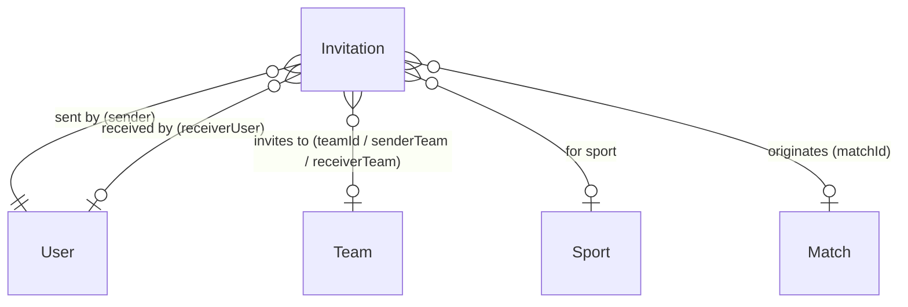

# Invitation Module Documentation

## 1. Purpose
The Invitation Module coordinates matchmaking and team recruitment communications across three distinct interaction types: Individual Player Match Invitations, Permanent Team Membership Invitations, and Opponent Team Challenges.

## 2. Responsibilities
- **Player Match Invitations**: Inviting individual discovered players for a specific match or recruitment request.
- **Team Membership Invitations**: Inviting players found via permanent numeric Player Code to join a permanent team roster.
- **Team Challenges**: Issuing structured match challenges between two distinct amateur teams.
- **State Lifecycle & Expiration**: Managing transitions between `pending`, `accepted`, `rejected`, `expired`, and `cancelled`.
- **Concurrency & Idempotency Protection**: Preventing double-acceptance, duplicate pending invitations, and overfilled rosters.
- **Availability Feedback Loop (Section 39)**: Prompting rejected recipients with activity preferences.

## 3. Folder Structure
```text
modules/invitations/
  models/
    invitation.model.js
  controllers/
    invitation.controller.js
  services/
    invitation.service.js
    invitationResponse.service.js
  validations/
    invitation.validation.js
  routes/
    invitation.routes.js
  invitation.md
```

## 4. Models
- `Invitation`:
  - `type`: `'player_match' | 'team_membership' | 'team_challenge'`
  - `sender`: ObjectId ref `User`
  - `receiverUser`: ObjectId ref `User`
  - `senderTeam`, `receiverTeam`, `teamId`: ObjectId ref `Team`
  - `matchId`: ObjectId ref `Match`
  - `sport`: ObjectId ref `Sport`
  - `proposedArrangement`: `{ scheduledAt, durationMinutes, venue, position, matchFormat }`
  - `message`: String
  - `status`: `'pending' | 'accepted' | 'rejected' | 'expired' | 'cancelled'`
  - `expiresAt`: Date
  - `respondedAt`: Date
  - `cancelledAt`: Date

## 5. Database Relationships


## 6. Controllers
- `createInvitation`: Validates type-specific requirements, creates invitation, emits real-time notification.
- `getReceivedInvitations`: Lists received invitations with filtering and pagination.
- `getSentInvitations`: Lists sent invitations.
- `getInvitationById`: Details of a specific invitation (restricted to sender/receiver).
- `acceptInvitation`: Accepts invitation and triggers domain side effects (membership confirmation, match scheduling).
- `rejectInvitation`: Rejects invitation and returns availability preference options.
- `cancelInvitation`: Allows sender to cancel a pending invitation.

## 7. Service Functions
- `createInvitation(senderId, data)`: Resolves recipient (by ObjectId or Player Code), validates availability, prevents duplicate pending invitations, persists document, emits Socket.IO event.
- `acceptInvitation(invitationId, requesterId)`: Rechecks expiration directly, atomically marks `accepted`, creates confirmed `TeamMembership` or schedules a `Match` if challenge.
- `rejectInvitation(invitationId, requesterId, reason)`: Marks `rejected`, emits real-time event, returns Section 39 activity options.
- `cancelInvitation(invitationId, senderId)`: Verifies sender authorization, marks `cancelled`.

## 8. APIs
- `POST   /api/v1/invitations`
- `GET    /api/v1/invitations/received`
- `GET    /api/v1/invitations/sent`
- `GET    /api/v1/invitations/:id`
- `PATCH  /api/v1/invitations/:id/accept`
- `PATCH  /api/v1/invitations/:id/reject`
- `PATCH  /api/v1/invitations/:id/cancel`

## 9. Request Examples
### Create Player Match Invitation
```http
POST /api/v1/invitations
Authorization: Bearer <JWT_ACCESS_TOKEN>
Content-Type: application/json

{
  "type": "player_match",
  "receiverUser": "6738b556b9c9f00123456789",
  "sportSlug": "football",
  "teamId": "6738c112b9c9f00123456701",
  "proposedArrangement": {
    "scheduledAt": "2026-11-20T18:00:00Z",
    "venue": "Green Turf Arena",
    "position": "midfielder",
    "durationMinutes": 90
  },
  "message": "Hey, need a solid midfielder for our Friday evening match!"
}
```

## 10. Response Examples
```json
{
  "success": true,
  "message": "Invitation sent successfully",
  "data": {
    "_id": "6738c890b9c9f00123456788",
    "type": "player_match",
    "sender": { "username": "ayeman", "fullName": "Ayeman Singh", "playerCode": "7281946" },
    "receiverUser": { "username": "devansh", "fullName": "Devansh Singh", "playerCode": "9382715" },
    "status": "pending",
    "expiresAt": "2026-11-20T18:00:00.000Z"
  }
}
```

## 11. Complete Request Flow
```text
Captain Action (Send Invitation)
  ↓
invitationCreationLimiter (Redis rate limit: 20/min)
  ↓
validateInvitationCreate (type-specific field rules)
  ↓
invitation.service.js
  ├─ Resolves recipient (Player Code lookup if provided)
  ├─ Rechecks recipient effective availability (Section 74)
  ├─ Checks partial unique index for duplicate pending invitations
  ├─ Persists Invitation with 48h default expiration
  └─ Emits Socket.IO event 'invitation:new' to receiver room
  ↓
Recipient Action (Accept Invitation)
  ↓
invitationResponse.service.js
  ├─ Rechecks expiry date directly against server clock
  ├─ Atomically marks status = 'accepted'
  ├─ If team_membership -> Creates confirmed TeamMembership
  ├─ If team_challenge -> Creates scheduled Match in Match collection
  └─ Emits Socket.IO event 'invitation:accepted' to sender
```

## 12. MongoDB Queries & Indexes
- Querying received invitations: `{ receiverUser: 1, status: 1, type: 1 }`
- Querying sent invitations: `{ sender: 1, status: 1 }`
- TTL & Expiration reference: `{ expiresAt: 1 }`
- Unique Pending Constraint:
  ```javascript
  { sender: 1, receiverUser: 1, type: 1, teamId: 1 },
  { unique: true, partialFilterExpression: { status: "pending" } }
  ```

## 13. Redis Usage
- Rate limiting for invitation creation: `ratelimit:invitations:create:<userId>` (20 req/min).

## 14. Regex and Validation
- Valid types: `['player_match', 'team_membership', 'team_challenge']`.
- Statuses: `['pending', 'accepted', 'rejected', 'expired', 'cancelled']`.
- Message length: Max 500 characters.

## 15. Authorization
- Senders must own the team if creating a team invitation or challenge.
- Only the target `receiverUser` can accept or reject an invitation.
- Only the original `sender` can cancel an invitation.

## 16. Security Considerations
- Prevents invitation spam via Redis rate limits.
- Validates player availability in real-time to avoid sending unwanted match invites to offline/busy users.
- Rejection responses never expose internal system data.

## 17. Edge Cases Handled
- **Expired Invitation Acceptance**: Always checks `now > expiresAt` directly before acceptance.
- **Concurrent Acceptance**: Atomic state transition prevents duplicate executions.
- **Rejection Activity Prompt (Section 39)**: Rejection response includes structured activity options.

## 18. Integration Dependencies
- `modules/teams/`: Confirmed membership updates.
- `modules/matches/`: Scheduled match creation upon challenge acceptance.
- `modules/availability/`: Availability rechecks before dispatching match invitations.
- `socket/`: Real-time push updates.

## 19. Environment Variables
- `REDIS_URL`: Redis rate-limiting backend.

## 20. Known Limitations
- Background TTL cleanup worker for expired records will be managed alongside BullMQ cron schedules.

## 21. Testing Status
Automated testing, API testing, and performance benchmarking have intentionally not been performed during this implementation phase.

## 22. Future Improvements
- Interactive in-app chat attachment on invitation cards.
