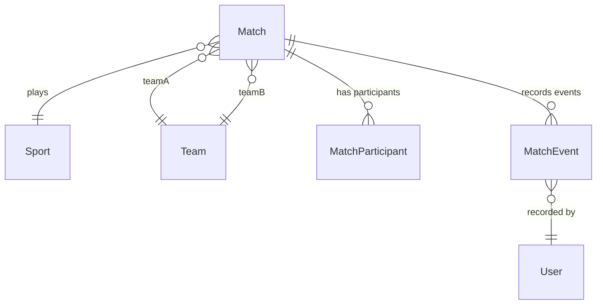

# Match Module Documentation

## 1. Purpose
The Match Module manages the lifecycle of amateur sports matches, scheduling, lineups, live scoring events, Socket.IO broadcasts, and dual-captain final result verification.

## 2. Responsibilities
- **Match Lifecycle**: Managing transitions: `proposed` → `scheduled` → `live` → `pending_verification` → `completed` (plus `cancelled`, `disputed`, `forfeited`).
- **Participant Management**: Ensuring confirmed player lineups, statistics persistence, and preventing duplicate participation.
- **Live Event-Based Scoring**: Real-time scoring strategies for Football, Cricket, Basketball, Racket Sports (Badminton, Tennis, Pickleball, TT), Chess, and Swimming.
- **Socket.IO Integration**: Broadcasting real-time live events and score summaries to match rooms (`match:<matchId>`).
- **Result Verification & Disputes (Section 57)**: Independent dual-captain confirmation workflow with administrator dispute resolution.

## 3. Folder Structure
```text
modules/matches/
  models/
    match.model.js
    matchParticipant.model.js
    matchEvent.model.js
  controllers/
    match.controller.js
    matchScore.controller.js
  services/
    match.service.js
    matchLifecycle.service.js
    matchScoring.service.js
    matchVerification.service.js
  scoring/
    football.scoring.js
    cricket.scoring.js
    basketball.scoring.js
    racketSports.scoring.js
    otherSports.scoring.js
  validations/
    match.validation.js
  routes/
    match.routes.js
  match.md
```

## 4. Models
- `Match`: `sport`, `teamA`, `teamB`, `originatingInvitation`, `matchFormat`, `scheduledAt`, `durationMinutes`, `venue`, `scorekeeper`, `status`, `scoreSummary`, `startedAt`, `endedAt`, `verificationData`, `verifiedResult`, `disputeData`.
- `MatchParticipant`: `match`, `authUser`, `team`, `side` (`teamA` | `teamB`), `status` (`confirmed` | `substituted` | `no_show`), `stats`.
- `MatchEvent`: `match`, `sport`, `eventType`, `side`, `player`, `eventData`, `recordedBy`, `serverTimestamp`, `clientEventId`, `correctionReference`.

## 5. Database Relationships


## 6. Controllers
- `match.controller.js`: `createMatch`, `getMyMatches`, `getMatchById`, `scheduleMatch`, `startMatch`, `endMatch`, `confirmResult`, `disputeResult`, `resolveDispute`.
- `matchScore.controller.js`: `recordEvent`, `getLiveScore`.

## 7. Service Functions
- `match.service.js`: CRUD, listing user's matches, rescheduling.
- `matchLifecycle.service.js`: Starting match (`scheduled` → `live`), ending match (`live` → `pending_verification`, preliminary result computation).
- `matchScoring.service.js`: Idempotent event recording via `clientEventId`, applying sport scoring logic, Socket.IO broadcast.
- `matchVerification.service.js`: Dual-captain independent confirmation (`teamAConfirmed` + `teamBConfirmed` → `completed`), dispute submission and admin resolution.

## 8. APIs
- `POST   /api/v1/matches` — Create match
- `GET    /api/v1/matches/my-matches` — List my matches
- `GET    /api/v1/matches/:matchId` — Match details
- `PATCH  /api/v1/matches/:matchId/schedule` — Reschedule match
- `POST   /api/v1/matches/:matchId/start` — Start match
- `POST   /api/v1/matches/:matchId/events` — Record live scoring event
- `GET    /api/v1/matches/:matchId/score` — Get live score
- `POST   /api/v1/matches/:matchId/end` — End match
- `POST   /api/v1/matches/:matchId/confirm-result` — Captain confirm result
- `POST   /api/v1/matches/:matchId/dispute-result` — Captain dispute result
- `POST   /api/v1/matches/:matchId/resolve-dispute` — Admin resolve dispute

## 9. Request Examples
### Record Scoring Event
```http
POST /api/v1/matches/6738c890b9c9f00123456788/events
Authorization: Bearer <JWT_ACCESS_TOKEN>
Content-Type: application/json

{
  "eventType": "goal",
  "side": "teamA",
  "player": "6738b556b9c9f00123456789",
  "clientEventId": "evt_goal_1700000000_1",
  "eventData": {
    "minute": 24,
    "assistedBy": "Rahul Sharma"
  }
}
```

## 10. Response Examples
```json
{
  "success": true,
  "message": "Event recorded successfully",
  "data": {
    "event": {
      "eventType": "goal",
      "side": "teamA",
      "serverTimestamp": "2026-11-20T18:24:00.000Z"
    },
    "scoreSummary": {
      "teamA": { "goals": 1 },
      "teamB": { "goals": 0 },
      "currentMinute": 24,
      "half": 1
    }
  }
}
```

## 11. Complete Request Flow
```text
Scorekeeper Records Event
  ↓
validateMatchEvent (validates eventType, side, payload)
  ↓
matchScoring.service.js
  ├─ Checks scorekeeper authorization
  ├─ Verifies match.status === 'live'
  ├─ Checks clientEventId for idempotent duplicate prevention
  ├─ Delegates to sport strategy (football.scoring.js)
  ├─ Persists MatchEvent document
  ├─ Updates match.scoreSummary
  └─ Emits Socket.IO 'match:score_update' to room 'match:<matchId>'
  ↓
Captains Confirm Final Result
  ↓
matchVerification.service.js
  ├─ Captain A confirms -> teamAConfirmed = true
  ├─ Captain B confirms -> teamBConfirmed = true
  └─ Both confirmed -> status = 'completed'
```

## 12. MongoDB Queries & Indexes
- `Match`:
  - `{ status: 1, scheduledAt: 1 }`
  - `{ teamA: 1, teamB: 1 }`
- `MatchParticipant`:
  - `{ match: 1, authUser: 1 }` (unique compound index)
- `MatchEvent`:
  - `{ match: 1, serverTimestamp: 1 }`
  - `{ clientEventId: 1 }` (unique sparse index)

## 13. Redis Usage
- Socket.IO adapter pub/sub support when scaled to multiple instances.

## 14. Regex and Validation
- Match format string validation.
- Date validation for schedule and start/end timestamps.

## 15. Authorization
- Starting match: Team captains or assigned scorekeeper.
- Scoring events: Only the assigned scorekeeper.
- Ending match: Scorekeeper or team captain.
- Confirming/Disputing result: Competing team captains.
- Dispute resolution: Platform administrator.

## 16. Security Considerations
- Prevents unauthorized scoring manipulation.
- Prevents tampering with confirmed match results.
- Complete immutable event log in `MatchEvent` collection.

## 17. Edge Cases Handled
- **Idempotent Scoring Retries (Section 56)**: Network retries with duplicate `clientEventId` return cached result without double-counting points.
- **Independent Result Confirmation (Section 57)**: A single captain cannot unilaterally complete a match; both captains must independently agree on the result version.

## 18. Integration Dependencies
- `modules/sports/`: Sport rule parameters.
- `modules/teams/`: Competing teams.
- `socket/`: Live score broadcasting.

## 19. Environment Variables
- `ACCESS_TOKEN_SECRET`: JWT verification for scorekeepers and captains.

## 20. Known Limitations
- Advanced ball-by-ball cricket wagon wheels will be integrated with detailed tracking in future frontend versions.

## 21. Testing Status
Automated testing, API testing, and performance benchmarking have intentionally not been performed during this implementation phase.

## 22. Future Improvements
- Automated rating update hooks upon match completion.
