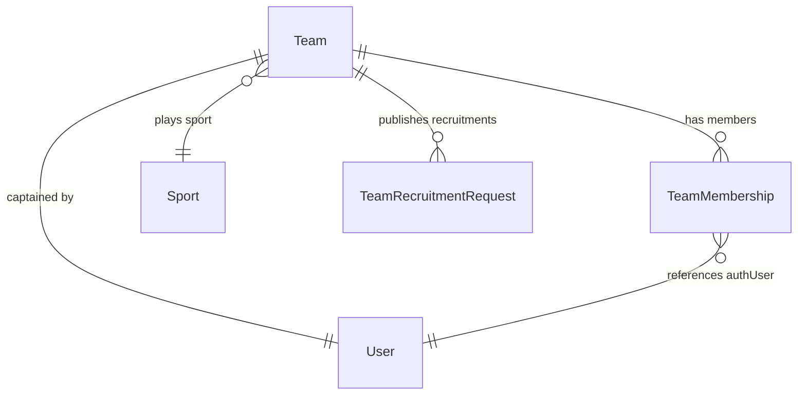

# Team Module Documentation

## 1. Purpose
The Team Module manages amateur sports teams, both temporary match-based squads and permanent clubs, including captaincy, confirmed memberships, playing location H3 indexes, and lineup eligibility verification.

## 2. Responsibilities
- **Team Management**: Creation, settings updates, and status tracking for permanent and temporary teams.
- **Captaincy & Transfer**: Atomic captaincy transfers and permissions enforcement.
- **Membership Management**: Adding friends via unique Player Code invitations, roster viewing, and member removal.
- **Lineup Eligibility Verification (Section 47)**: Pre-match checks ensuring confirmed memberships, valid sport registrations, and no cross-lineup player conflicts.
- **Recruitment Requests**: Posting and managing explicit team recruitment requirements.
- **Temporary-to-Permanent Conversion**: Converting temporary match squads into permanent clubs upon consensus.

## 3. Folder Structure
```text
modules/teams/
  models/
    team.model.js
    teamMembership.model.js
    teamRecruitmentRequest.model.js
  controllers/
    team.controller.js
    teamMembership.controller.js
    recruitment.controller.js
  services/
    team.service.js
    teamMembership.service.js
    teamEligibility.service.js
    recruitment.service.js
  validations/
    team.validation.js
  routes/
    team.routes.js
  team.md
```

## 4. Models
- `Team`: `name`, `sport`, `captain`, `description`, `logo`, `type` (`temporary` | `permanent`), `preferredPlayingLocation.geo`, `h3Cells.res7`, `h3Cells.res8`, `matchFormats`, `visibility`, `challengeEnabled`, `status`.
- `TeamMembership`: `team`, `authUser`, `role` (`captain` | `member`), `status` (`confirmed` | `pending` | `inactive`), `joinedAt`.
- `TeamRecruitmentRequest`: `team`, `captain`, `sport`, `preferredPositions`, `requiredPlayerCount`, `acceptedPlayerCount`, `scheduledAt`, `durationMinutes`, `playingLocation`, `h3Cells`, `status`.

## 5. Database Relationships


## 6. Controllers
- `team.controller.js`: `createTeam`, `getMyTeams`, `getTeamById`, `updateTeam`, `convertToPermanent`, `checkTeamEligibility`.
- `teamMembership.controller.js`: `getTeamMembers`, `removeMember`, `transferCaptain`.
- `recruitment.controller.js`: `createRecruitment`, `getTeamRecruitments`, `updateRecruitment`.

## 7. Service Functions
- `team.service.js`:
  - `createTeam(captainId, data)`: Calculates dual H3 cells server-side, saves Team, registers captain in `TeamMembership`.
  - `getMyTeams(authUserId)`: Returns all teams where user holds confirmed membership.
  - `getTeamById(teamId)`: Returns team details with member counts.
  - `updateTeam(teamId, captainId, updates)`: Updates settings and re-indexes H3 if location changes.
  - `convertToPermanent(teamId, captainId)`: Converts temporary squad to permanent club.
- `teamMembership.service.js`:
  - `getTeamMembers(teamId)`: Lists confirmed members with player profile details.
  - `removeMember(teamId, targetUserId, requesterId)`: Removes member (authorized for captain or self-removal).
  - `transferCaptain(teamId, currentCaptainId, newCaptainId)`: Atomic transfer in both Team and TeamMembership.
- `teamEligibility.service.js`:
  - `validateLineupEligibility(teamId, playerUserIds, requiredSportId, requiredLineupSize)`: Verifies lineup integrity.
  - `checkCrossLineupConflicts(lineupA, lineupB)`: Ensures no single player plays for both opposing teams.

## 8. APIs
- `POST   /api/v1/teams` — Create team
- `GET    /api/v1/teams/my-teams` — List my teams
- `GET    /api/v1/teams/:teamId` — Team details
- `PATCH  /api/v1/teams/:teamId` — Update team settings
- `POST   /api/v1/teams/:teamId/convert-to-permanent` — Convert temporary to permanent
- `GET    /api/v1/teams/:teamId/eligibility` — Check lineup eligibility
- `GET    /api/v1/teams/:teamId/members` — List members
- `DELETE /api/v1/teams/:teamId/members/:userId` — Remove member / leave team
- `POST   /api/v1/teams/:teamId/transfer-captain` — Transfer captaincy
- `POST   /api/v1/teams/:teamId/recruitment` — Post recruitment request
- `GET    /api/v1/teams/:teamId/recruitment` — List recruitment requests
- `PATCH  /api/v1/teams/:teamId/recruitment/:requestId` — Update recruitment request

## 9. Request Examples
### Create Team
```http
POST /api/v1/teams
Authorization: Bearer <JWT_ACCESS_TOKEN>
Content-Type: application/json

{
  "name": "Delhi Strikers FC",
  "sportSlug": "football",
  "description": "Amateur weekend 7v7 football club in South Delhi",
  "type": "permanent",
  "preferredPlayingLocation": {
    "coordinates": [77.209, 28.6139],
    "venueName": "Siri Fort Sports Complex",
    "city": "New Delhi",
    "state": "Delhi"
  },
  "matchFormats": ["7v7", "11v11"],
  "challengeEnabled": true
}
```

## 10. Response Examples
```json
{
  "success": true,
  "message": "Team created successfully",
  "data": {
    "_id": "6738c112b9c9f00123456701",
    "name": "Delhi Strikers FC",
    "sport": { "name": "Football", "slug": "football" },
    "captain": "6738b556b9c9f00123456789",
    "type": "permanent",
    "h3Cells": { "res7": "872830828ffffff", "res8": "8828308281fffff" },
    "status": "active"
  }
}
```

## 11. Complete Request Flow
```text
Captain Creates Team
  ↓
validateTeamCreate (validates location coordinates, sport)
  ↓
team.service.js
  ├─ Resolves Sport document
  ├─ Computes H3 cells server-side (res 7 and res 8)
  ├─ Saves Team document
  └─ Registers captain in TeamMembership (status: confirmed)
  ↓
Captain Adds Friends via Player Code
  ↓
Calls POST /api/v1/invitations with receiverPlayerCode & teamId
  ↓
Recipient Accepts Invitation
  ↓
TeamMembership confirmed
```

## 12. MongoDB Queries & Indexes
- `Team`:
  - `{ "preferredPlayingLocation.geo": "2dsphere" }`
  - `{ sport: 1, status: 1, challengeEnabled: 1, "h3Cells.res7": 1 }`
  - `{ sport: 1, status: 1, challengeEnabled: 1, "h3Cells.res8": 1 }`
- `TeamMembership`:
  - `{ team: 1, authUser: 1 }` (unique compound index)
  - `{ authUser: 1, status: 1 }`

## 13. Redis Usage
- Discovery rate limits for searching opponent teams.

## 14. Regex and Validation
- Team name length: 1 to 60 characters.
- Coordinates validated via `validateGeoCoordinates`.

## 15. Authorization
- Team settings modification restricted to the team captain.
- Captaincy transfer restricted to the current captain.
- Member removal permitted for captain or the member themselves.

## 16. Security Considerations
- Prevents captain departure without assigning a successor.
- Strict isolation of private user details in team member listings.

## 17. Edge Cases Handled
- **Separate Playing Location (Section 43)**: Teams use a dedicated home ground/venue rather than exposing the captain's private home address.
- **Cross-Lineup Conflicts (Section 47)**: Prevents the same player from appearing on both opposing rosters.

## 18. Integration Dependencies
- `modules/sports/`: Authoritative sport validation.
- `modules/userSports/`: Player sport registration check during lineup eligibility.
- `modules/invitations/`: Membership invitation issuance.

## 19. Environment Variables
- Standard MongoDB & Redis variables.

## 20. Known Limitations
- Roster sizes currently unlimited; maximum roster caps configurable per sport in future iterations.

## 21. Testing Status
Automated testing, API testing, and performance benchmarking have intentionally not been performed during this implementation phase.

## 22. Future Improvements
- Team tournament registration and team chat integration.
